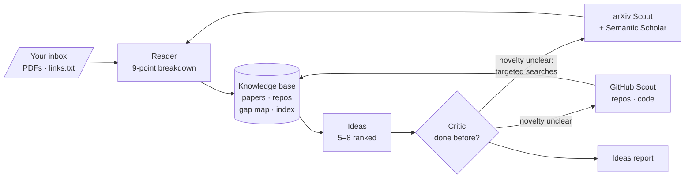

# Embodied AI Research Assistant


**Give it an embodied-AI topic, such as humanoid whole-body control. Five agents find the papers and the code, break every paper down, keep a growing knowledge base and gap map in your Obsidian vault, and propose several research ideas, each checked for whether it has already been done.**

It is built for one job: finding what to work on next. Summaries alone don't get you there, so every paper note separates the limitations the authors admit from the ones they don't. The gap map shows which approach × capability combinations nobody has covered, and a critic checks each idea against the literature before you see it.

> This grew out of [multi-agent-research-tool](https://github.com/RoKenobi/multi-agent-research-tool), a daily "community buzz → brief" pipeline, which stays there.

## Architecture



| Agent | Model (default) | Job |
|---|---|---|
| arXiv Scout | Sonnet, low effort | Writes 4–6 searches, adds papers that cite or are cited by the top hits (Semantic Scholar), skips papers already read, ranks the rest |
| GitHub Scout | Sonnet, low effort | Finds implementations, controllers, simulators and benchmarks; links repos to papers by arXiv id in their READMEs |
| Reader | Opus, high effort | Reads the LaTeX source (PDF, then abstract as fallbacks) and writes the 9-point breakdown plus gap-map tags |
| Ideas | Opus, high effort | Reads a compact digest of every paper in the topic, the gap map and the repos; proposes ranked improvements tied to gaps |
| Critic | Opus, high effort | Marks each idea novel / partly done / done / unclear with cited papers, judges feasibility for your lab, and asks for targeted searches when unsure |

The loop is bounded: at most `max_critic_rounds` (2) critic rounds and `followup_papers` (5) extra papers per run.

### One run

1. Papers you dropped in the topic's `inbox/` are always read and don't count toward the cap.
2. Both scouts search. Anything already in the knowledge base is skipped, so nothing is read or paid for twice.
3. The Reader breaks down each new paper, two at a time, and every finished paper is saved immediately.
4. Repos are saved and the gap map is rebuilt from every paper in the topic, past runs included.
5. Ideas proposes improvements; the Critic reviews them, possibly after one round of targeted searches.
6. The ideas report is written.

If your Claude plan's usage limit hits mid-run, the run stops with exit code 2 and keeps everything read so far. Run the same command later and it carries on.

### What lands in your vault

```
Research/
└── humanoid-whole-body-control/        one folder per topic
    ├── papers/2307.15818.md            9-point breakdown
    ├── repos/owner__repo.md            code, stars, linked papers, why it matters
    ├── gap-map.md                      approach × capability; "—" cells are gaps
    ├── ideas/2026-10-24.md             ranked ideas with novelty verdicts
    ├── inbox/                          drop PDFs or links.txt here
    │   └── processed/
    └── index.json                      what's been read, for dedupe and resume
```

Every paper note has the same sections: **Problem, Approach, Setup** (robot, simulator, sim or real, training cost), **Results, Limitations** (stated and unstated), **Future work, Code & data, Key references, Relevance** (with a 0–3 lab-fit score).

## Under the hood

**Claude on your plan, not an API key.** Every LLM call is a `claude -p --output-format json` subprocess, so it uses your Claude Code login and plan limits. Two flags matter. `--safe-mode` (with `--strict-mcp-config` and `--disable-slash-commands`) skips your plugins, hooks, skills and CLAUDE.md, which otherwise add about 68K input tokens to every call; with it, overhead is about 600. `--bare` would also skip them but breaks the login, so it's never used. Prompts go in on stdin because Windows caps command lines at about 32K characters.

**LaTeX first.** The Reader gets the paper's LaTeX source from arXiv with the preamble, comments and bibliography stripped and `\input` files inlined, so the budget goes to the method and the maths. PDF text and then the abstract are fallbacks, and the note says which one was used.

**Citations, not just keywords.** [Semantic Scholar](https://www.semanticscholar.org/) knows which papers cite which. The arXiv Scout pulls the references and citations of its top hits, which catches related work that uses different words for the same idea.

**A gap map that lines up.** The Reader is shown the tags already in the knowledge base and asked to reuse them, so `push recovery` doesn't also appear as `disturbance rejection` and split a column.

**Your lab in every prompt.** `config.yaml` names your robots (Unitree G1, AgiBot X2) and simulator (MuJoCo by default). Matching work ranks a little higher and feasibility notes say how well an idea ports, but work on other simulators is never treated as irrelevant.

**Observability.** Each run is one Langfuse trace, `research | <topic>`, with a span per agent and every Claude call recorded as a generation with model, prompt, reply and tokens. The dollar figure is the CLI's API-equivalent estimate and is labelled as such; you're billed through your plan.

## Quickstart

### 1. Install

```bash
python -m venv .venv
.venv\Scripts\activate          # macOS/Linux: source .venv/bin/activate
pip install -r requirements.txt
```

You also need [Claude Code](https://claude.com/claude-code), logged in. Check with `claude -p "hi"`.

### 2. Configure

```bash
cp .env.example .env            # Langfuse keys and optional GITHUB_TOKEN
```

Set `vault_path` in `config.yaml` to your Obsidian vault, and check the `lab` section.

### 3. Run

```bash
python pipeline.py "humanoid whole-body control"
```

Run it again on the same topic to grow that knowledge base; run it on another topic to start a new one.

### Self-hosting Langfuse

Traces go to a Langfuse server you run yourself, on any always-on Linux box with Docker. It's the official six-container stack (web, worker, Postgres, ClickHouse, Redis, MinIO) and idles at about 2.5 GB RAM. The files in `deploy/langfuse/` add three things on top: ClickHouse capped at 3 GB with smaller caches, sign-ups disabled, and a pre-created org, project and API keys.

```bash
# on the server
mkdir ~/langfuse && cd ~/langfuse
curl -fsSL https://raw.githubusercontent.com/langfuse/langfuse/main/docker-compose.yml -o docker-compose.yml
# copy deploy/langfuse/* from this repo into ~/langfuse, then:
sh gen-env.sh <server-ip> <your-email>
docker compose up -d
```

Open `http://<server-ip>:3000` and log in with the email you gave and the password in `.env` (`LANGFUSE_INIT_USER_PASSWORD`). Then change the password in the dashboard. Copy `LANGFUSE_INIT_PROJECT_PUBLIC_KEY` and `LANGFUSE_INIT_PROJECT_SECRET_KEY` into this project's `.env` as `LANGFUSE_PUBLIC_KEY` / `LANGFUSE_SECRET_KEY`, and set `LANGFUSE_HOST=http://<server-ip>:3000`.

The dashboard is plain HTTP, so keep it on your LAN or Tailscale and don't forward port 3000. To upgrade, re-download `docker-compose.yml` and run `docker compose pull && docker compose up -d`. Tracing is optional: if the server is down, runs carry on untraced.

## Configuration

| Key | Default | What it does |
|---|---|---|
| `vault_path` | — | Your Obsidian vault (must exist) |
| `research_folder` | `Research` | Folder in the vault that holds topic folders |
| `lab.robots` / `lab.simulators` | `Unitree G1`, `AgiBot X2` / `MuJoCo` | Used for relevance ranking and feasibility |
| `models.fast` / `models.deep` | `claude-sonnet-5-5` / `claude-opus-5-5` | Scouts / Reader, Ideas, Critic |
| `effort.fast` / `effort.deep` | `low` / `high` | Effort per tier |
| `arxiv_category_filter` | `(cat:cs.RO OR cat:cs.LG OR cat:cs.AI OR cat:cs.CV)` | ANDed onto every arXiv search; `""` searches everything |
| `arxiv_results_per_query` | `8` | Hits per search query |
| `max_new_papers` | `15` | New papers per run, follow-ups included (inbox papers are extra) |
| `followup_papers` | `5` | Reserved for the Critic's targeted searches |
| `max_critic_rounds` | `2` | Critic reviews per run |
| `max_repos` | `10` | Repos kept per scout pass |
| `paper_char_budget` | `40000` | Characters of each paper body sent to the Reader |
| `llm_concurrency` | `2` | Papers read at the same time |
| `llm_timeout_sec` | `600` | Per-call timeout |

`.env`: `LANGFUSE_PUBLIC_KEY`, `LANGFUSE_SECRET_KEY`, `LANGFUSE_HOST` (all optional), and `GITHUB_TOKEN` (optional; raises GitHub search from 10 to 30 requests a minute).

## Project structure

```
pipeline.py              CLI, graph, critic loop, caps, usage-limit stop
agents/
  scout_arxiv.py         queries, citation neighbours, dedupe, ranking
  scout_github.py        repo search, paper linking, filtering
  reader.py              paper -> 9-point breakdown + tags
  ideas.py               knowledge base -> ranked ideas
  critic.py              novelty and feasibility verdicts, follow-up queries
core/
  llm.py                 claude -p wrapper, usage-limit detection, Langfuse generations
  kb.py                  topic folders, notes, gap map, ideas report, inbox, index
  jsonparse.py           JSON out of model replies
  config.py, tracing.py
sources/                 arXiv (+ LaTeX/PDF), GitHub, Semantic Scholar
deploy/langfuse/         self-hosting files
tests/                   65 tests, no network, no plan usage
```

## Tests

```bash
pip install -r requirements-dev.txt
pytest
```

The tests replace `claude -p`, every HTTP call and every agent with fakes, so they make no network calls and spend nothing.

## Stack

| Layer | Choice |
|---|---|
| Orchestration | Plain Python, one bounded loop |
| LLM | Claude via Claude Code CLI (`claude -p`) on a Claude plan |
| Papers | arXiv API + LaTeX source, PyMuPDF fallback, Semantic Scholar citations |
| Code | GitHub REST search |
| Observability | [Langfuse](https://langfuse.com) v4, self-hosted |
| Output | Obsidian vault (Markdown + YAML frontmatter) |
